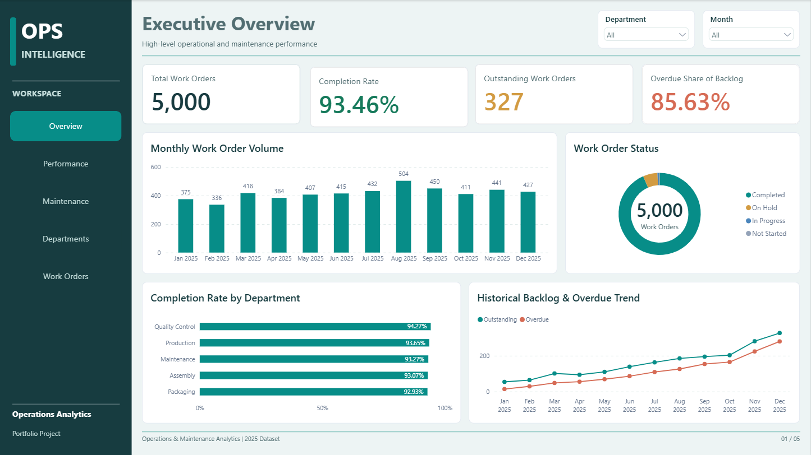

# OPS Intelligence | Operations & Maintenance Analytics

**Power BI portfolio project · Synthetic 2025 work-order dataset · Five dashboard pages**

OPS Intelligence is a five-page operational reporting project designed to explore work-order volume, completion timeliness, maintenance backlog, department-level performance, and individual work-order details. All results shown here come from **synthetic data** and do not represent actual company performance or realized savings.

## Dashboard preview

| Page | Focus |
| --- | --- |
| [01 — Executive Overview](screenshots/01_executive_overview.png) | Work-order volume, completion, backlog and trends |
| [02 — Operational Performance](screenshots/02_operational_performance.png) | Completion timeliness and duration |
| [03 — Maintenance & Backlog](screenshots/03_maintenance_backlog.png) | Overdue exposure, aging and historical snapshots |
| [04 — Department Analysis](screenshots/04_department_analysis.png) | Five-department comparisons |
| [05 — Work Order Details](screenshots/05_work_order_details.png) | Filterable record-level register |

## Selected findings (synthetic data)

| Metric | Value |
| --- | ---: |
| Work orders | 5,000 |
| Departments | 5 |
| Completed work orders | 4,673 |
| Completion rate | 93.46% |
| On-time completions | 4,198 |
| On-time completion rate | 89.84% |
| Outstanding at 2025-12-31 | 327 |
| Overdue at 2025-12-31 | 280 |
| Overdue share of backlog | 85.63% |
| Average completion time | 2.63 day boundaries |
| Average days overdue | 128.64 |

## Tools and analytical approach

- **Power BI** for the interactive report, navigation, slicers and visualization design.
- **DAX** for completion metrics, overdue counts, aging, and historical backlog snapshots.
- **Calendar table** with a completion-date relationship for period-based analysis.
- **Disconnected category tables** for selected donut and aging analyses.
- **Validation** of totals, department rollups, slicer behavior, charts, and 5,000 unique work-order IDs.

The reporting date is capped at **December 31, 2025**. Backlog measures evaluate whether orders existed and remained incomplete as of the selected snapshot date, rather than merely counting orders created in that month. Average completion duration uses `DATEDIFF(..., DAY)`, which counts day boundaries crossed, not exact 24-hour elapsed intervals.

## Documentation

- [Illustrated case study](docs/OPS_Intelligence_Illustrated_Case_Study.docx)
- [Technical methodology](docs/TECHNICAL_METHODOLOGY.md)
- [Data dictionary starter](docs/DATA_DICTIONARY.md)
- [Release and QA notes](docs/QA_AND_RELEASE.md)

## Reproducing or exploring the report

The Power BI report is available at [`powerbi/OPS_Intelligence.pbix`](powerbi/OPS_Intelligence.pbix) and the synthetic source workbook at [`data/Operations_Dataset.xlsx`](data/Operations_Dataset.xlsx). Open the PBIX in Power BI Desktop. If Power Query requests a local Excel path, point the source to the included workbook and refresh. Verify all five portfolio pages after refreshing. The final PBIX includes five visible portfolio pages and two hidden validation pages; the temporary `Final QA` page was removed before repository publication. Interactive Power BI Service hosting is not configured by this repository.

## Responsible use

All work orders are synthetic. These figures illustrate analytical methods and are not evidence of real-world operational improvement. The dashboard was developed through a hands-on, AI-assisted learning and troubleshooting workflow; technical decisions and test results should be explainable by the project author.

## Project status

Five portfolio pages passed user-executed functional QA and a self-reported 20-point release review. The final PBIX includes five visible portfolio pages and two hidden validation pages; the temporary `Final QA` page was removed. This GitHub repository is publicly published. Interactive Power BI Service hosting has not yet been configured.
